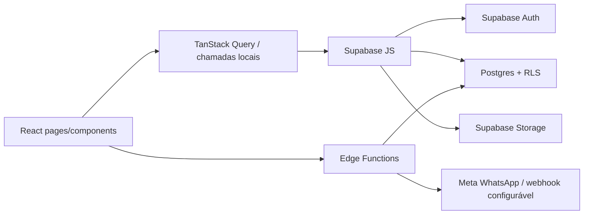

# Arquitetura, Dados e Segurança

## Stack observada

- Vite 5 + React 18 + TypeScript 5;
- React Router 6;
- TanStack Query 5;
- React Hook Form + Zod;
- Tailwind CSS 3, shadcn/ui e Radix UI;
- Supabase JS 2 para Auth, Postgres, Storage e Edge Functions;
- Vitest para testes unitários;
- Playwright para E2E;
- Vercel como alvo de hospedagem (`vercel.json`);
- jsPDF/html2canvas para PDFs no frontend.

## Organização atual

```text
src/
  components/          componentes por domínio e biblioteca ui/
  contexts/            autenticação e branding
  hooks/               acesso, papéis e cadastros auxiliares
  integrations/        cliente e tipos gerados do Supabase
  lib/                 regras puras, PDF, CEP e agenda/renovação
  pages/clinic/         aplicação interna
  pages/portal/         portal do paciente
  test/                 testes unitários
supabase/
  functions/            Edge Functions em Deno
  migrations/           evolução do schema e RLS
e2e/                    testes Playwright de smoke e jornadas
```

## Fluxo de execução



## Domínios de dados identificados

### Identidade e tenancy

`clinics`, `user_roles`, `team_invitations`, `roles`, `professionals`, `class_entities`, `professional_treatments`, `patient_users`, `patient_portal_access`.

### Controle de acesso

`access_groups`, `access_group_permissions`, `user_access_groups` e função `has_menu_access`.

### Comercial

`leads`, `lead_interactions`, `lead_stage_history`, `proposals`, `proposal_items`, `contracts`, metas e tarefas/interações de renovação.

### Clínico e paciente

`patients`, `payers`, `patient_anamneses`, `treatments`, categorias, custos, combos, `session_records`, métricas, fotos, documentos e feedbacks.

### Agenda

`appointments`, disponibilidade profissional, bloqueios, lista de espera, notificações da espera, lembretes, tokens/comandos WhatsApp e execuções de jobs.

### Financeiro

Planos e parcelas legados, além do modelo mais novo de meios, planos e parcelas vinculados ao contrato; existem RPCs para previsão financeira.

### Experiência e comunicação

`notifications`, `nps_responses`, conversas/mensagens/configurações de WhatsApp IA e logs de auditoria.

## Edge Functions observadas

| Função | Uso |
|---|---|
| `create-clinic` | provisionamento/onboarding |
| `invite-team-member` | convite de colaborador |
| `invite-patient` | acesso ao portal |
| `check-waitlist` | matching de lista de espera |
| `send-appointment-reminder` | envio unitário de lembrete |
| `dispatch-appointment-reminders` | despacho da fila |
| `process-appointment-whatsapp` | webhook/comandos inbound |
| `send-daily-agenda-summary` | resumo diário |
| `run-agenda-jobs` | orquestração e idempotência |
| `whatsapp-ai-agent` | agente conversacional MVP |

## Autenticação e autorização

- O `AuthContext` recupera sessão e confirma o usuário com `getUser()`.
- `ProtectedRoute` separa aplicação interna e portal por papel.
- A sidebar aplica papel e permissão de menu.
- O banco usa RLS e funções auxiliares como `is_clinic_staff`, `has_clinic_role`, `auth_clinic_id` e vínculos do paciente.

Regras obrigatórias para mudanças:

1. Toda tabela exposta deve ter RLS.
2. Toda policy precisa restringir tenant/ownership; `TO authenticated` sozinho não autoriza por clínica.
3. Policy de `UPDATE` deve ter `USING` e `WITH CHECK` quando ownership puder mudar.
4. Nunca usar `user_metadata` para autorização; usar dados protegidos/app metadata ou tabelas próprias.
5. Nunca colocar `service_role` ou secret key no Vite/frontend.
6. Views expostas devem usar `security_invoker = true` quando suportado.
7. Funções `SECURITY DEFINER` exigem justificativa, schema não exposto, validação de `auth.uid()` e grants mínimos.
8. Storage precisa de policies por bucket e caminho/tenant; upsert requer SELECT + INSERT + UPDATE.

## Problema estrutural atual: tipos defasados

`src/integrations/supabase/types.ts` não representa todas as migrations recentes. O código contorna isso com casts como `.from('tabela' as unknown)` e objetos `any`. Isso reduz segurança de tipos e esconde divergências de schema.

Antes de uma feature de banco:

1. confirmar o projeto Supabase correto;
2. comparar banco remoto, migrations e tipos;
3. corrigir drift de migrations;
4. regenerar tipos do schema real;
5. remover casts apenas no escopo afetado;
6. validar RLS com ao menos dois tenants e os papéis relevantes.

## Convenção recomendada para novas features

Não adicionar mais lógica a páginas gigantes. Preferir:

```text
src/features/<feature>/
  api/          queries, mutations e DTOs
  components/   UI específica do domínio
  hooks/        composição de estado e efeitos
  schemas/      validação Zod
  utils/        regras puras
  types.ts
```

As páginas devem compor a feature e controlar navegação, não concentrar SQL, regra de negócio, dezenas de estados e modais.

## Estado e dados

- TanStack Query para estado remoto, cache, invalidação e mutations.
- Estado local apenas para interação efêmera de UI.
- Regras determinísticas em funções puras com Vitest.
- Invariantes críticas preferencialmente no banco.
- Operações multi-etapa críticas devem usar RPC/transação, não uma sequência frágil no browser.
- Datas persistidas em UTC; apresentação em `America/Sao_Paulo`, salvo configuração futura por clínica.
- Valores financeiros com `numeric` no banco e inteiro em centavos ou biblioteca decimal no cliente; nunca depender de float para fechamento.

## Migrations

- Não editar migrations já aplicadas.
- Criar migrations novas pelo Supabase CLI, após confirmar a versão/comando com `--help`.
- Testar primeiro em ambiente não produtivo.
- Rodar advisors e revisar RLS, funções, triggers e grants.
- Regenerar tipos depois do schema estabilizado.
- Manter seed separado de migration estrutural.

## Variáveis conhecidas

Frontend usa somente:

- `VITE_SUPABASE_URL`
- `VITE_SUPABASE_PROJECT_ID`
- `VITE_SUPABASE_PUBLISHABLE_KEY`

Secrets de WhatsApp e funções estão documentados nos runbooks da raiz e devem permanecer no ambiente de Edge Functions. Nunca copiá-los para arquivos `VITE_*`.

