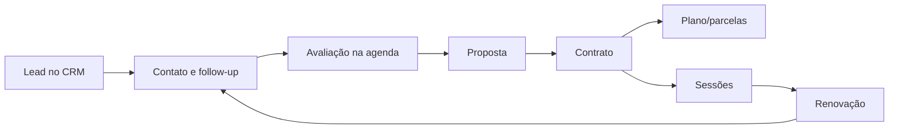

# Produto, Fluxos e Requisitos

## Jornada comercial principal

Regras já documentadas/testadas no projeto:

- Kanban com etapas configuráveis e histórico de mudança;
- responsável, prioridade, interações e follow-up;
- agendamento de avaliação vinculado ao lead;
- proposta criada a partir do CRM;
- contrato gerado a partir da negociação;
- navegação contextual de retorno entre CRM, proposta e contrato;
- renovação detectada a partir da execução das sessões.

## Jornada de atendimento

1. Paciente é cadastrado ou convertido a partir do fluxo comercial.
2. Anamnese/documentos são coletados e seu estado aparece no hub.
3. Tratamento contratado alimenta agenda e sessões.
4. Profissional executa sessão e registra evolução, métricas e fotos.
5. Paciente fornece feedback/NPS.
6. Sinais negativos geram alertas; aproximação do fim gera renovação.

## Ciclo de agenda

Fluxo padrão observado: `scheduled → confirmed → in_progress → completed`, com exceções de remarcação, cancelamento e no-show.

Capacidades adicionais:

- profissional não atribuído;
- reatribuição;
- disponibilidade e bloqueios;
- lista de espera e matching;
- lembretes outbound;
- confirmação/cancelamento inbound via WhatsApp;
- resumo diário e jobs idempotentes.

Estado funcional histórico: a lista de espera foi marcada como MVP funcional; WhatsApp e resumo diário foram descritos como fundação/MVP, ainda dependentes de configuração, deploy e UAT real.

## Renovação

O módulo cria tarefas sem duplicar o Kanban. Regras descritas:

- tratamentos com várias sessões disparam próximo do fim (`N-2`, com exceção para `N=2`);
- sessão única usa uma janela configurável após a sessão;
- evita tarefa ativa duplicada por paciente, tratamento e contrato;
- sugere próximo tratamento por heurísticas;
- permite WhatsApp, ligação, reavaliação, snooze, conversão ou descarte.

## Financeiro

O produto possui contratos, condições de pagamento, parcelas e previsão. Há sinais de evolução de um modelo legado (`payment_plans`, `payment_installments`) para estruturas específicas do contrato. Antes de evoluir este domínio, documentar canonicamente:

- qual modelo é fonte de verdade;
- como renegociação afeta parcelas;
- estados e transições válidas;
- cálculo de previsto, recebido, vencido e inadimplente;
- conciliação e estorno;
- relação entre pagador e paciente.

## Requisitos não funcionais obrigatórios

### Segurança e privacidade

- isolamento completo por clínica e por paciente;
- princípio do menor privilégio;
- trilha de auditoria para alterações sensíveis;
- nenhum dado pessoal em logs, prompts de IA ou analytics sem necessidade e base legítima;
- revisão LGPD para prontuário, fotos, documentos, anamnese e WhatsApp;
- exclusão/anonimização e retenção precisam de política de negócio formal.

### Qualidade

- lint, testes unitários e build passando;
- E2E para jornada alterada;
- loading, vazio, erro, sucesso e retry explícitos;
- comportamento responsivo;
- nenhuma regressão de permissões/RLS;
- observabilidade de automações e integrações.

### Performance

- code splitting por rota/feature;
- paginação ou virtualização para listas extensas;
- consultas selecionando apenas colunas necessárias;
- índices para filtros e joins críticos;
- evitar cascatas de requests por linha;
- definir budgets de bundle e Web Vitals.

## Definition of Ready

Uma história só entra em codificação quando contém:

- problema e usuário afetado;
- resultado mensurável;
- fluxo principal e exceções;
- regra de negócio e estados;
- impacto em permissões, dados e integrações;
- wireframe ou referência visual se houver UI;
- critérios de aceite testáveis;
- arquivos prováveis e riscos;
- plano de rollout/migração quando aplicável.

## Definition of Done

- critérios de aceite demonstrados;
- TypeScript e lint sem novos débitos;
- testes proporcionais ao risco passando;
- RLS e isolamento validados quando houver dados;
- acessibilidade e responsividade verificadas;
- estados de UI completos;
- documentação e tipos atualizados;
- sem secrets ou dados pessoais no diff;
- diff revisável, sem refatoração não relacionada;
- evidências anexadas: comandos, resultados e capturas quando úteis.

